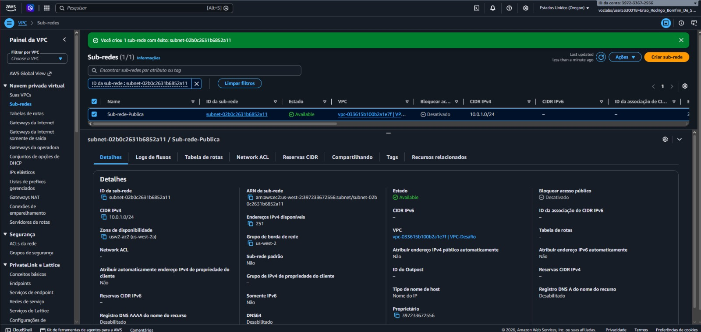
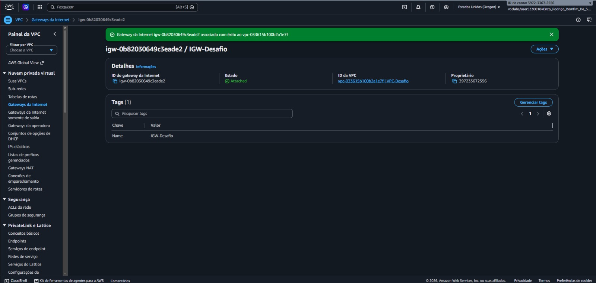
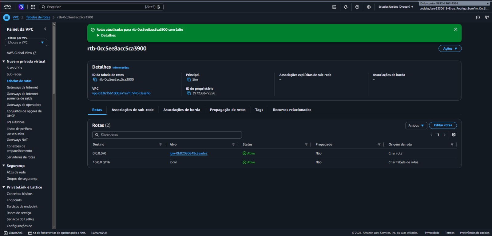
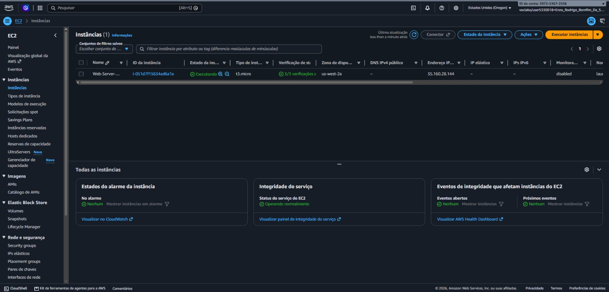
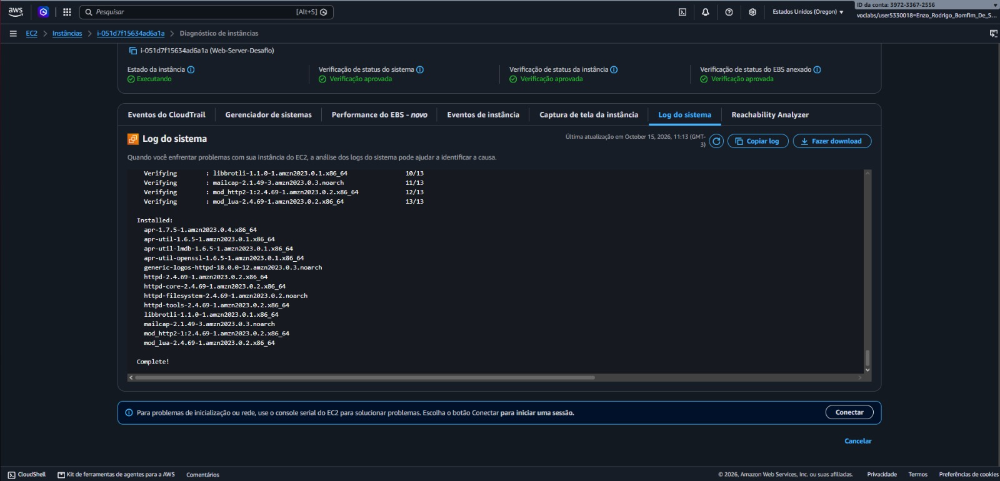
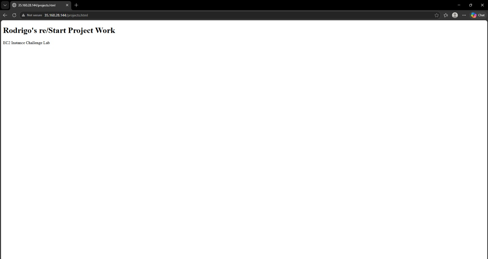

# 📸 Project Implementation & Verification Screenshots

### 1. Custom VPC and Public Subnet Creation

Creation of the custom Virtual Private Cloud (`10.0.0.0/16`) and public subnet (`10.0.1.0/24`).

The VPC provides an isolated virtual network environment in the AWS cloud, while the subnet segments the address space within a specific Availability Zone to host public-facing resources.

---

### 2. Internet Gateway Attachment

Creation of the Internet Gateway and attachment to the custom VPC.

The Internet Gateway serves as a horizontally scaled, redundant, and highly available VPC component that enables communication between instances inside the VPC and the public internet.

---

### 3. Route Table Configuration

Configuration of the public Route Table and explicit subnet association.

The route table defines the routing rules for outbound network traffic, directing all internet-bound requests (`0.0.0.0/0`) from the public subnet directly to the attached Internet Gateway.

---

### 4. EC2 Instance Provisioning

Configuration and launch of the Amazon Linux EC2 instance (`t3.micro`).

The instance is provisioned inside the custom public subnet with auto-assigned public IPv4 addressing, an 8 GiB General Purpose SSD (`gp2`) root volume, and a stateful Security Group allowing inbound HTTP (`80`) and SSH (`22`) traffic.

---

### 5. System Log Verification (Apache `httpd` Installation)

Verification of the EC2 instance system console output after bootstrapping.

The system log confirms that the Apache HTTP Server (`httpd`) package and its required dependencies were properly installed and initialized on the Amazon Linux operating system.

---

### 6. Live Web Application Verification

External browser test accessing the deployed `projects.html` web page via the instance's public IPv4 address.

This final verification confirms end-to-end connectivity across the Internet Gateway, Public Route Table, Security Group firewall rules, and the active Apache web server daemon.

