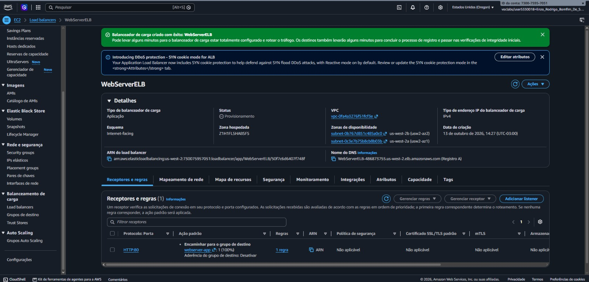
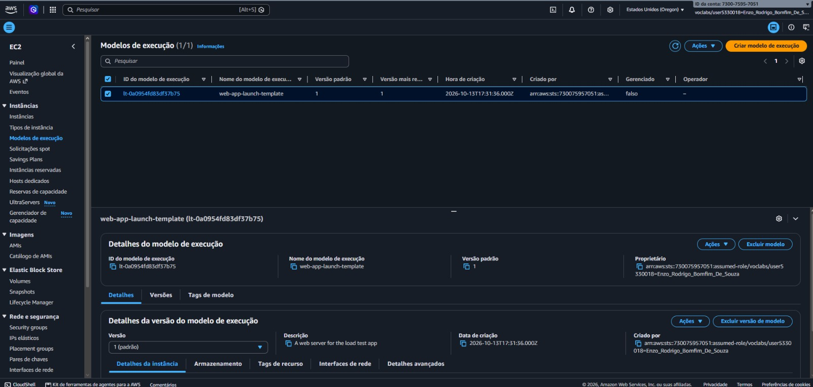
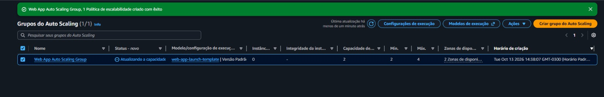
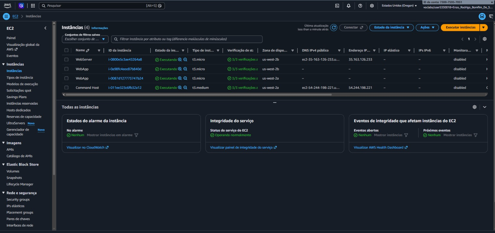
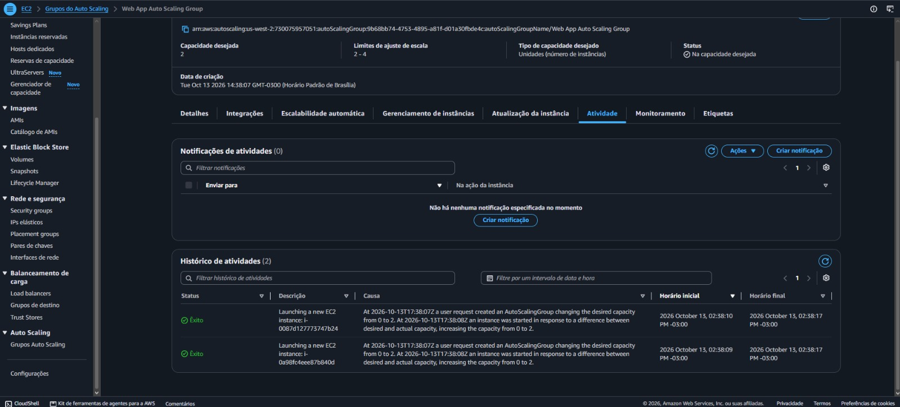
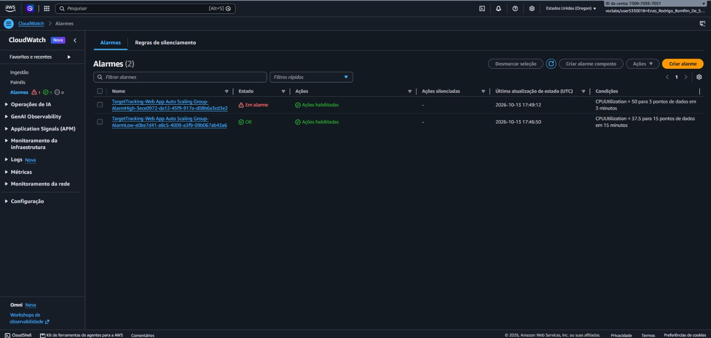
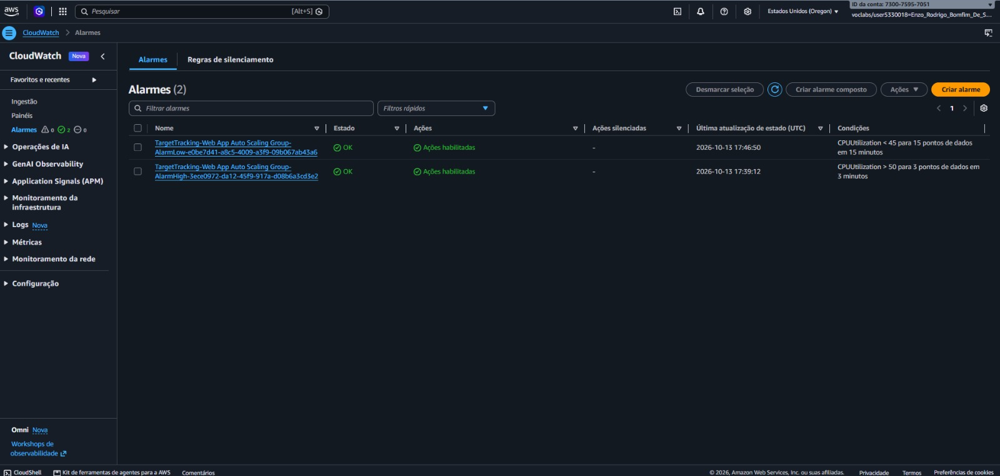
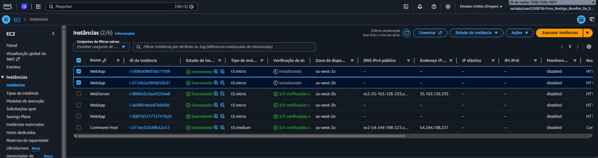

### 1. Application Load Balancer Configuration
Application Load Balancer creation and network configuration across two Availability Zones.

The load balancer provides a single entry point for incoming HTTP traffic and distributes requests across registered application instances.

### 2. Launch Template Configuration
Creation of the EC2 Launch Template.

The Launch Template defines the configuration used to provision application instances, including the custom AMI, instance type, and security group.

### 3. Auto Scaling Group Configuration

Creation and configuration of the EC2 Auto Scaling group.

The group is configured to manage instance capacity across two private subnets in separate Availability Zones, with a minimum capacity of two instances and a maximum capacity of four.

### 4. Initial EC2 Instances Provisioned

EC2 instances launched and managed by the Auto Scaling group.

The initial instances are provisioned using the Launch Template and registered with the load balancer's target group, enabling health checks and traffic distribution.

### 5. Load Test Execution

Execution of the application's load testing functionality.

The test generates additional CPU workload to evaluate the Auto Scaling policy's response to increased demand.

### 6. Scale-Out Event Triggered by High CPU Utilization

The Auto Scaling group launches an additional EC2 instance following increased CPU utilization.

Amazon CloudWatch detects that average CPU utilization has exceeded the configured 50% target, triggering the scale-out process.

### 7. CloudWatch Alarm During the Load Test

CloudWatch alarm state after the load test increases CPU utilization.

The alarm reflects the elevated workload and the scaling policy's response to increased demand.

### 8. CloudWatch Alarm Returns to a Normal State

CloudWatch alarm state after the additional instance becomes available.

Following the scaling activity and subsequent metric evaluation, the alarm returns to its normal state, indicating that the alarm condition is no longer being met.

### 9. EC2 Instance Launch Activity

EC2 instances being launched following the Auto Scaling group's scaling activity.

This view documents the instance provisioning process associated with the scaling event and helps illustrate how the infrastructure responds to workload changes.

