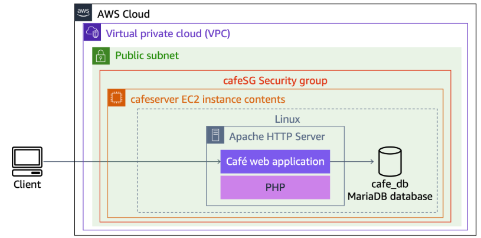

# ☁️ AWS Load Balancing & Auto Scaling

<p align="center">
  
  
  
</p>

<p align="center">
  <strong>Designing scalable, resilient, and highly available cloud infrastructure.</strong>
  <br />
  A hands-on AWS project exploring load balancing, horizontal scaling, private networking, and infrastructure monitoring.
</p>

---

## 📌 Project Overview

This project explores how to build a scalable web application architecture using AWS services.

The objective was to distribute incoming HTTP traffic across multiple Amazon EC2 instances and automatically adjust computing capacity in response to workload changes.

The architecture combines an **Application Load Balancer (ALB)**, an **EC2 Auto Scaling group**, private subnets across two Availability Zones, and Amazon CloudWatch monitoring.

Rather than relying on a single web server, this design allows the application infrastructure to expand as demand increases, while maintaining a defined minimum capacity.

> **Project type:** Hands-on cloud lab  
> **Cloud provider:** Amazon Web Services (AWS)  
> **Primary focus:** Load balancing, horizontal scaling, networking, and monitoring

## 🎯 Objectives

- Configure an Application Load Balancer to distribute HTTP traffic.
- Create an Amazon Machine Image (AMI) for consistent instance provisioning.
- Define a Launch Template for EC2 instances.
- Deploy an Auto Scaling group across two Availability Zones.
- Place application instances in private subnets.
- Configure target tracking based on average CPU utilization.
- Monitor scaling behavior using Amazon CloudWatch.
- Validate application access and target health.

## 🏗️ Architecture

### Architecture Design

The architecture separates public entry points from application compute resources.

Internet traffic reaches the Application Load Balancer through public subnets. The load balancer forwards requests to healthy EC2 instances running in private subnets across two Availability Zones.

The Auto Scaling group manages the number of instances, while CloudWatch metrics and alarms support scaling decisions.

**Architecture flow:**

`Internet → Application Load Balancer → Target Group → EC2 Instances`

The Auto Scaling group manages the EC2 fleet, and CloudWatch monitors its performance.

### Architecture Diagram

Add your architecture diagram to the project folder using the following path:

`architecture/aws-load-balancing-autoscaling.png`

Then display it here:

```markdown

```

The diagram should show:

- An Application Load Balancer in public subnets.
- Two Availability Zones.
- Private subnets containing the EC2 application instances.
- A target group connecting the load balancer to the instances.
- An Auto Scaling group managing instance capacity.
- CloudWatch monitoring and scaling metrics.

## 🧰 AWS Services Used

| Service | Purpose |
|---|---|
| Amazon EC2 | Hosts the web application instances. |
| Amazon Machine Image (AMI) | Provides a reusable image for launching instances. |
| Launch Template | Defines the configuration used to provision EC2 instances. |
| Application Load Balancer | Distributes incoming HTTP requests across registered targets. |
| EC2 Auto Scaling | Automatically adjusts the number of EC2 instances. |
| Amazon CloudWatch | Monitors metrics and scaling alarms. |
| Amazon VPC | Provides network isolation and subnet configuration. |
| Security Groups | Control permitted network traffic to AWS resources. |

## ⚙️ Implementation

### 1. Create an Amazon Machine Image

Created an AMI from the existing web server instance to preserve its configured environment and use it as the base image for additional application instances.

**Why it matters:** A reusable image helps standardize instance provisioning and reduces the need to configure each server independently.

### 2. Configure the Application Load Balancer

Created an internet-facing Application Load Balancer across two public subnets in separate Availability Zones.

Configured an HTTP listener and a target group to route incoming requests to the application instances.

**Why it matters:** The load balancer provides a single entry point for the application and routes requests to healthy registered targets.

### 3. Create a Launch Template

Configured a Launch Template using the custom AMI, the `t3.micro` instance type, and the appropriate security group.

**Why it matters:** Launch Templates provide a consistent configuration for instances created by Auto Scaling.

### 4. Configure the Auto Scaling Group

Created an Auto Scaling group using the Launch Template and selected private subnets across two Availability Zones.

The group was associated with the load balancer's target group, with Elastic Load Balancing health checks enabled.

**Why it matters:** The Auto Scaling group manages the application fleet while keeping the instances in the intended network locations.

### 5. Define the Scaling Policy

Configured a target tracking scaling policy based on average CPU utilization.

| Parameter | Value |
|---|---:|
| Minimum capacity | 2 instances |
| Desired capacity | 2 instances |
| Maximum capacity | 4 instances |
| Target average CPU utilization | 50% |
| Scaling policy | Target tracking |

The policy allows Auto Scaling to adjust the number of instances according to demand, subject to the configured capacity limits.

**Important:** The 50% target is a scaling policy target, not a guarantee that CPU utilization will remain exactly at 50% at all times.

### 6. Monitor Scaling Behavior

Used Amazon CloudWatch to inspect CPU utilization and the alarms associated with the target tracking policy.

A load test was triggered through the web application to increase CPU demand and observe the Auto Scaling group's response.

**Why it matters:** Monitoring helps validate the relationship between workload, performance metrics, alarms, and infrastructure scaling.

## 🧪 Validation & Results

The lab validation focused on three areas.

| Validation | Expected behavior |
|---|---|
| Application access | The web application is reachable through the load balancer's DNS name. |
| Target health | The registered EC2 instances become healthy in the target group. |
| Auto Scaling | Increased workload can trigger additional instances, within the configured capacity limits. |

During the lab, the application was accessed through the load balancer, target health was checked, and a load test was used to exercise the scaling configuration.

The intended scaling behavior was to start with two instances and allow the group to expand to a maximum of four instances when demand justified additional capacity.

### Evidence

Store your actual screenshots in the `screenshots/` directory.

## 🔐 Security Considerations

The architecture separates the public load balancer from the private application instances.

For a production implementation, I would further validate the following:

- Restrict application instance inbound traffic to the load balancer's security group.
- Avoid assigning public IP addresses to application instances unless specifically required.
- Permit only the necessary inbound and outbound network traffic.
- Use IAM roles instead of storing long-lived AWS credentials on instances.
- Consider HTTPS with an appropriate TLS certificate.
- Review CloudWatch monitoring, logging, and alerting requirements.
- Evaluate capacity limits, availability requirements, and cost implications.

These are production considerations, not claims that every item was implemented in this lab.

## 💡 Key Takeaways

This project helped reinforce several cloud engineering concepts:

- **Load balancing:** Distributing application traffic across multiple compute instances.
- **Horizontal scaling:** Increasing or decreasing the number of instances rather than relying exclusively on a larger server.
- **High availability:** Distributing resources across Availability Zones to reduce dependence on a single zone.
- **Private networking:** Separating application compute resources from the public entry point.
- **Health checks:** Using target health to determine whether instances are suitable for receiving traffic.
- **Monitoring-driven scaling:** Connecting infrastructure metrics to automated capacity decisions.
- **Infrastructure standardization:** Using AMIs and Launch Templates to provision instances consistently.

## 🚀 Potential Improvements

The following are possible future enhancements and were not part of the completed lab scope:

- Rebuild the architecture using Terraform.
- Configure HTTPS with AWS Certificate Manager.
- Add an AWS WAF web access control layer.
- Create more detailed CloudWatch dashboards and custom alarms.
- Evaluate load testing with a dedicated testing tool.
- Review scaling cooldowns, instance warm-up, and cost optimization.
- Document network flows and security group rules in greater detail.

These improvements would help extend the exercise into a more complete infrastructure project.

## 📂 Project Structure

```text
aws/load-balancing-autoscaling/
├── README.md
├── architecture/
│   └── aws-load-balancing-autoscaling.png
├── screenshots/
│   ├── 01-load-balancer-configuration.jpeg
│   ├── 02-launch-template-configuration.jpeg
│   ├── 03-auto-scaling-group-configuration.jpeg
│   ├── 04-initial-ec2-instances.jpeg
│   ├── 05-load-test-execution.jpeg
│   ├── 06-auto-scaling-scale-out-event.jpeg
│   ├── 07-cloudwatch-alarm-during-load-test.jpeg
│   ├── 08-cloudwatch-alarm-normalized.jpeg
│   └── 09-ec2-instance-launch-activity.jpeg
└── ...
```

Create only the files and directories you actually use. The structure above is a suggested organization.

## 📚 References

- [Amazon EC2 Auto Scaling](https://docs.aws.amazon.com/autoscaling/ec2/userguide/what-is-amazon-ec2-auto-scaling.html)
- [Elastic Load Balancing](https://docs.aws.amazon.com/elasticloadbalancing/latest/userguide/what-is-load-balancing.html)
- [Application Load Balancers](https://docs.aws.amazon.com/elasticloadbalancing/latest/application/introduction.html)
- [Amazon CloudWatch](https://docs.aws.amazon.com/AmazonCloudWatch/latest/monitoring/WhatIsCloudWatch.html)
- [Amazon VPC](https://docs.aws.amazon.com/vpc/latest/userguide/what-is-amazon-vpc.html)

---

<p align="center">
  <strong>Build. Learn. Understand. Improve.</strong>
  <br />
  <em>Documenting the journey from cloud fundamentals to practical engineering.</em>
</p>

## Additional Implementation: AWS Auto Scaling with Linux and AWS CLI

### Overview

This implementation explores a command-line-driven approach to provisioning an EC2-based web application and configuring an automatically scalable infrastructure on AWS.

The initial compute instance is created using the AWS CLI and configured through a user data script. An Amazon Machine Image (AMI) is then generated from the instance and reused as the base image for the Auto Scaling environment.

The remaining infrastructure is configured through the AWS Management Console, combining command-line provisioning with visual configuration and operational validation.

### Implementation Workflow

#### 1. Provision an EC2 Instance Using AWS CLI

The `aws ec2 run-instances` command is used to launch a Linux EC2 instance with the required AMI, instance type, subnet, security group, and user data configuration.

Example command structure:

```bash
aws ec2 run-instances \
  --key-name KEYNAME \
  --instance-type t3.micro \
  --image-id AMIID \
  --user-data file:///home/ec2-user/UserData.txt \
  --security-group-ids HTTPACCESS \
  --subnet-id SUBNETID \
  --associate-public-ip-address \
  --tag-specifications \
  'ResourceType=instance,Tags=[{Key=Name,Value=WebServer}]' \
  --output text \
  --query 'Instances[*].InstanceId'
```

The command returns the instance ID, which is used in subsequent operations.

The user data script automates the installation and initial configuration of the web application, including the load testing functionality.

#### 2. Validate Instance Initialization

After provisioning, the instance state is checked using the AWS CLI:

```bash
aws ec2 wait instance-running \
  --instance-ids NEW-INSTANCE-ID
```

The public DNS name can then be retrieved to verify application accessibility.

```bash
aws ec2 describe-instances \
  --instance-id NEW-INSTANCE-ID \
  --query 'Reservations[0].Instances[0].NetworkInterfaces[0].Association.PublicDnsName' \
  --output text
```

The application must be allowed sufficient time to complete its initialization before validation.

#### 3. Create a Custom AMI

The running web server instance is used to create a reusable image:

```bash
aws ec2 create-image \
  --name WebServerAMI \
  --instance-id NEW-INSTANCE-ID
```

The resulting AMI becomes the base image for instances launched by the Auto Scaling group.

This approach supports repeatable provisioning by preserving the configured application environment.

#### 4. Configure the Application Load Balancer

An Application Load Balancer is configured across two public subnets in separate Availability Zones.

A target group is created to register the application instances, with the health check configured to use the application's `/index.php` endpoint.

The load balancer provides a single DNS entry point and forwards requests to healthy registered targets.

#### 5. Create the Launch Template and Auto Scaling Group

A Launch Template is configured using the custom AMI, the `t3.micro` instance type, and the appropriate security group.

The Auto Scaling group is deployed across two private subnets in separate Availability Zones and associated with the load balancer's target group.

The scaling configuration is defined as follows:

| Parameter | Value |
|---|---|
| Minimum capacity | 2 instances |
| Desired capacity | 2 instances |
| Maximum capacity | 4 instances |
| Scaling metric | Average CPU utilization |
| Target value | 50% |

Elastic Load Balancing health checks are enabled to help the Auto Scaling group identify instances that are not healthy enough to serve application traffic.

#### 6. Validate Automatic Scaling

The web application is accessed through the load balancer DNS name. The application's load testing functionality is then used to increase CPU utilization.

The Auto Scaling group's Activity tab is monitored to observe scaling activities and determine whether additional instances are launched in response to increased demand.

The validation process includes:

- Confirming that the initial EC2 instances become healthy.
- Verifying that the target group reports healthy targets.
- Accessing the web application through the load balancer.
- Triggering the application's load testing functionality.
- Reviewing Auto Scaling activity and instance capacity changes.

The scaling policy targets an average CPU utilization of 50%. Actual scaling behavior depends on metric evaluation, policy evaluation periods, instance initialization, and other AWS service behavior.

### Key Technical Concepts

- **AWS CLI:** Command-line interaction with AWS services.
- **EC2 provisioning:** Launching instances with explicit configuration parameters.
- **AMI creation:** Capturing a reusable image of a configured instance.
- **Launch Templates:** Standardizing the configuration used to provision instances.
- **Application Load Balancing:** Distributing requests across healthy application targets.
- **Horizontal scaling:** Adjusting the number of EC2 instances based on demand.
- **Health checks:** Evaluating target health before routing application traffic.
- **CloudWatch monitoring:** Observing performance metrics associated with scaling decisions.

### Potential Improvements

Future iterations could extend this implementation through:

- Terraform-based infrastructure provisioning.
- Automation of resource creation using AWS CLI scripts.
- HTTPS configuration using AWS Certificate Manager.
- More detailed CloudWatch dashboards and operational alerts.
- Additional validation of security group rules and network access.
- Cost analysis and evaluation of scaling behavior under different workloads.

These improvements represent potential future work rather than features implemented in this exercise.

### Environment and Security Notes

This implementation was performed in a learning environment. Resource names, instance types, and configuration values may differ in other environments.

The commands above use placeholders for environment-specific values. Replace them with the appropriate values only when executing in an authorized AWS environment.

Never commit AWS credentials, private keys, access tokens, or other sensitive information to a public repository.

Resources should be reviewed and terminated when no longer required to avoid unnecessary costs.
